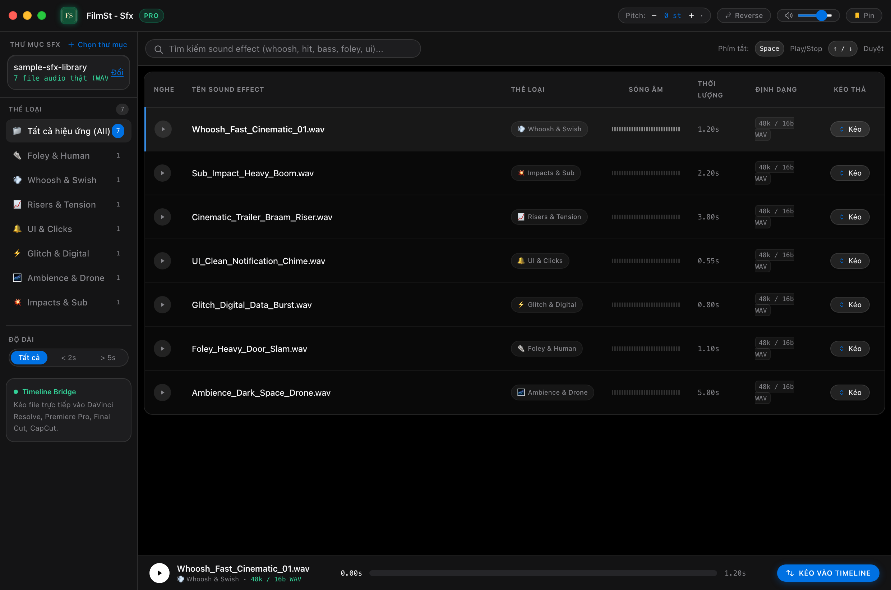

# FilmSt - Sfx 🎬🎵

Ứng dụng Desktop cao cấp chuẩn Apple dành cho Video Editor và Sound Designer: **Quản lý, nghe thử và kéo thả sound effect (SFX) trực tiếp vào timeline dựng phim**.



---

### ✨ Tính năng nổi bật
1. **Phân loại tự động (Auto Classification)**:
   - Tự động nhận diện và phân loại âm thanh thành 9 thể loại: *Whoosh & Swish*, *Impacts & Sub*, *Risers & Tension*, *UI & Clicks*, *Glitch & Digital*, *Foley & Human*, *Ambience & Drone*, *Cinematic & Trailer*, *Magic & Sci-Fi*.
   - Đọc thông tin kỹ thuật WAV RIFF header: Sample rate (44.1k, 48k, 96k), Bit depth (24-bit, 16-bit), thời lượng chính xác.

2. **Kéo thả chuẩn Native OS vào Timeline dựng phim (Full-Row Drag & Drop)**:
   - Sử dụng native OS drag bridge (`event.sender.startDrag`).
   - Nhấp và kéo từ bất kỳ đâu trên dòng file hoặc nút kéo để thả thẳng vào:
     - **DaVinci Resolve** (Timeline track hoặc Media Pool)
     - **Adobe Premiere Pro** (Timeline hoặc Project Panel)
     - **Final Cut Pro**
     - **CapCut PC / Mac**

3. **Audition & Sóng âm trực quan (Interactive Waveform)**:
   - Hiển thị sóng âm theo biên độ thực tế.
   - Click bất kỳ điểm nào trên sóng âm để tua ngay (Scrubbing).
   - **Pitch Shift**: Tăng/giảm cao độ (-12 st đến +12 st) để nghe thử âm thanh trước khi kéo vào video.
   - **Reverse**: Đảo ngược âm thanh tức thì.
   - **Phím tắt nhanh**:
     - `Space`: Phát / Tạm dừng
     - `↑` / `↓`: Chọn file kế tiếp / trước đó
     - `Esc`: Dừng phát

4. **Kiểm tra cập nhật tự động (GitHub Releases Auto-Update)**:
   - Tự động kiểm tra bản phát hành mới trên GitHub.
   - Nút kiểm tra cập nhật và hiển thị badge thông báo phiên bản mới đi kèm Release Notes.

5. **Chế độ Always On Top & Mini Mode**:
   - Ghim ứng dụng nổi trên các phần mềm dựng phim.
   - Nút **Mini**: Thu nhỏ thành palette gọn gàng cạnh timeline dựng.

---

### 🚀 Khởi chạy ứng dụng (Chế độ phát triển)

```bash
cd /Users/david/Documents/sfx-flow-app
./run.sh
```

---

### 📦 Đóng gói Desktop App (macOS)

1. **Đóng gói file `.app` (Chạy thử ngay):**
```bash
npm run pack:mac
# File .app được tạo tại: release/mac-arm64/FilmSt - Sfx.app
```

2. **Đóng gói file `.dmg` cài đặt và `.zip` để phát hành GitHub:**
```bash
npm run dist:mac
# File .dmg được tạo tại: release/FilmSt - Sfx-1.0.0-arm64.dmg
```

---

### 🌐 Cách đẩy lên GitHub & Tạo bản cập nhật (Releases)

1. **Khởi tạo và đẩy mã nguồn lên GitHub:**
```bash
cd /Users/david/Documents/sfx-flow-app
git add .
git commit -m "feat: initial commit for FilmSt - Sfx"
git branch -M main
git remote add origin https://github.com/<tai-khoan-cua-anh>/<ten-repo>.git
git push -u origin main
```

2. **Phát hành bản cập nhật (Release):**
- Lên GitHub, vào mục **Releases** -> **Draft a new release**.
- Đặt tag version mới (ví dụ: `v1.0.1`).
- Đính kèm file `release/FilmSt - Sfx-1.0.0-arm64.dmg` hoặc `.zip` đã build.
- Bấm **Publish release**. Mọi người dùng mở app sẽ nhận được thông báo cập nhật tự động!
```

Chế độ lập trình (Hot Reload):
```bash
npm run dev
```

---

### 📦 Thư viện mẫu đi kèm
Trong thư mục `sample-sfx-library/` đã tạo sẵn 7 file WAV 48kHz chuẩn chất lượng cao để anh có thể chọn và kiểm tra ngay lập tức:
- `Whoosh_Fast_Cinematic_01.wav`
- `Sub_Impact_Heavy_Boom.wav`
- `Cinematic_Trailer_Braam_Riser.wav`
- `UI_Clean_Notification_Chime.wav`
- `Glitch_Digital_Data_Burst.wav`
- `Foley_Heavy_Door_Slam.wav`
- `Ambience_Dark_Space_Drone.wav`
